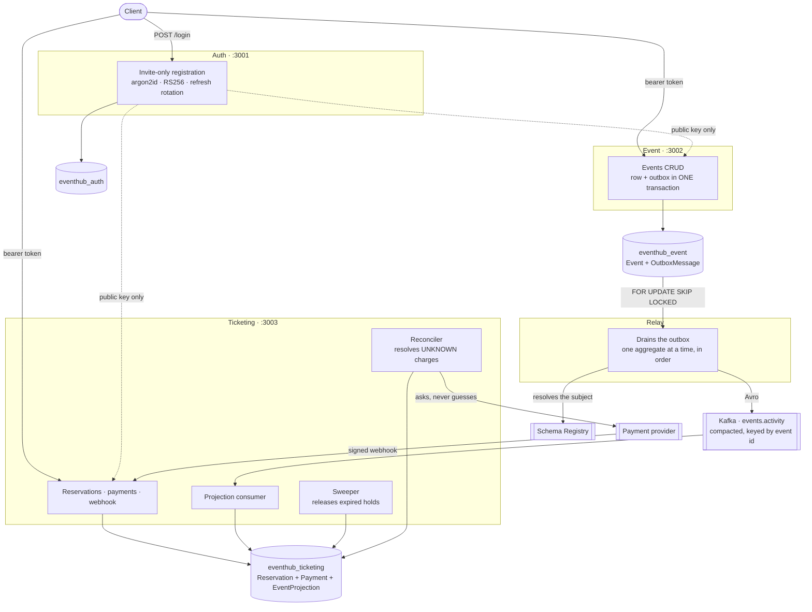

# EventHub

A multi-tenant event and community platform, built as four services over Postgres
and Kafka.

It exists to be **explainable**. Every non-obvious decision in this repository has
a comment saying what it is working around, and most of them are working around
something specific — a Postgres behaviour, a Kafka guarantee, or a failure that
was observed rather than imagined. Where the code claims a property, there is
usually a script that demonstrates it and a CI step that re-checks it on every
pull request.

## The problems it actually solves

Anyone can wire up CRUD. These are the parts that took thought.

**Two people buy the last seat at the same time.** The naive read-then-write has
no protection under `READ COMMITTED` — both transactions read `remaining = 1`,
both conclude they may proceed, and the seat sells twice. Wrapping it in a
transaction changes nothing, because transactions give atomicity, not mutual
exclusion. The fix is to make the check and the write *one statement*, so the
second transaction blocks on the row lock and then re-evaluates its `WHERE`
clause against the newest committed row. CI fires 40 concurrent buyers at 5 seats
and asserts exactly 5 succeed.

**The payment provider doesn't answer.** Not fails — *fails to answer*. The
charge may have succeeded and the reply may have been lost, and nothing on this
side can tell. So `UNKNOWN` is a first-class state, distinct from `FAILED`:
rounding "I don't know" down to "no" releases seats that were genuinely paid for.
An unanswered charge keeps its seats held and stays unsettled, and a reconciler
resolves it later by **asking the provider** rather than guessing. There are
exactly two wrong ways to resolve a stuck charge and one right one.

**The money and the seats live in different systems.** There is no transaction
spanning both, so the payment endpoint is three phases with a commit between
each. One transaction wrapped around the provider call is wrong twice over: it
holds a row lock across a network call, and it's a lie — the database can roll
back, the charge cannot.

**A webhook arrives with no tenant.** Every row-security policy here reads
`app.tenant_id`, so the application role sees *zero rows* for a payment that
plainly exists. The tempting fix is to read the tenant off the signature-verified
payload — but authenticity is not authority; that would let the request choose
whose rows it modifies. The webhook says *which payment*; the database says
*whose*. The cross-tenant reach is one `SELECT` of one column.

**One service can't join to another's tables.** Database-per-service with
`CONNECT` revoked means Ticketing genuinely cannot read Event's data. So it
consumes an event stream and maintains a projection instead. That is the honest
price of the architecture: a join becomes a subscription, and you inherit
at-least-once delivery, out-of-order arrival, and the need to dedupe.

## Tenant isolation is enforced by Postgres, not by application code

Row-level security with `FORCE`, role-targeted policies, and a per-transaction
session variable. Three details make it real rather than decorative:

- A table owner **silently bypasses its own policies**, so services connect as a
  separate non-owner role. Migrations run as the owner and therefore see zero
  rows under `FORCE` — which has bitten this repo three times during backfills,
  each one documented in the migration that hit it.
- Foreign keys, unique constraints and cascading deletes all run **outside** row
  security. So every child references a `(tenantId, id)` pair rather than a bare
  id, and no unique index omits `tenantId` — otherwise a `23505` would reveal that
  another tenant already used a value.
- Grants are explicit per table, with no `ALTER DEFAULT PRIVILEGES`. A forgotten
  policy is therefore also a forgotten grant, and the service fails loudly instead
  of quietly serving rows across every tenant. **Fail closed.**

CI asserts that no table anywhere is missing RLS unless it is on a documented
exemption list — and each exemption has to be justified in its migration, because
an exemption nobody wrote down is indistinguishable from a policy somebody forgot.

## What's here

| | |
|---|---|
| `services/auth` | Invite-only registration, argon2id, RS256 JWTs, refresh rotation with family reuse detection, password reset |
| `services/event` | Events CRUD with a transactional outbox |
| `services/relay` | Drains an outbox, Avro-encodes, publishes to Kafka, dead-letters poison rows |
| `services/ticketing` | Projection consumer, seat reservation, hold sweeper, payment path, payment reconciler, provider webhook |
| `contracts/` | Avro schemas, and TypeScript types generated from them |
| `db/init/` | Three databases and nine roles, with `CONNECT` revoked from `PUBLIC` |
| `scripts/verify-*.mjs` | 43 executable proofs of the invariants above |

Three separate Postgres databases with their own credentials. CI asserts across
all six directions that no service can even open a connection to another's.

## How it fits together



**The dotted lines are not calls.** Auth is the only service holding a private
key; Event and Ticketing hold only the public half, so they can prove a token is
genuine and cannot mint one. A compromise of either grants no ability to forge an
identity, which is the whole reason for RS256 rather than a shared secret.

**The solid line that matters most is `DBEVENT → RELAY`.** Event never publishes
to Kafka. It writes the event row and an outbox row in one transaction, so there
is no window where the row exists and the message does not, or the reverse — the
failure every "save, then publish" design has. The relay is what turns those
committed rows into messages, and everything hard about this repository lives in
that hop: ordering per aggregate, at-least-once delivery, retries with backoff,
poison rows that must dead-letter rather than block their aggregate for ever.

**And `KAFKA → PROJ` is the price of database-per-service.** Ticketing cannot
join to Event's tables — `CONNECT` is revoked, so it genuinely cannot reach them —
so it subscribes and maintains its own projection. That buys isolation and costs
at-least-once delivery, out-of-order arrival and the need to dedupe, which is why
the projection carries a source version and refuses to go backwards.

The topic is **compacted**, so Kafka keeps only the last message per key. That
makes the ordering above load-bearing in a way that is easy to miss: publish v3
before v2 and compaction keeps v2, so a rebuild from the topic reconstructs the
wrong state — permanently, and silently. `scripts/verify-projection-rebuild.mjs`
is what holds that line.

## Running it

Two ways. The first needs nothing installed but Docker and is how to see the
system work; the second is how to develop on it.

### Everything in containers, one command

```bash
docker compose up -d --wait
```

That builds one image, shared by all four services, and then:

1. waits for Postgres, Kafka and the Schema Registry to pass their healthchecks
2. runs a `setup` container that migrates all three databases, seeds Auth,
   creates the Kafka topics, registers the Avro schemas, and generates a signing
   keypair into a volume
3. and only then starts Auth, Event, Ticketing and the outbox relay

`--wait` returns when every container is **healthy**, so a zero exit status means
the system is up rather than merely that the containers were created.

| Service   | URL                     |
| --------- | ----------------------- |
| Auth      | `http://localhost:3001` |
| Event     | `http://localhost:3002` |
| Ticketing | `http://localhost:3003` |
| Relay     | `http://localhost:3010/metrics` |

Proof that it is working end to end, rather than just listening — sign in as the
seeded admin, create an event through one service, and read it back out of
another service's Kafka-fed projection:

```bash
TOKEN=$(curl -sf -X POST http://localhost:3001/login \
  -H 'Content-Type: application/json' -H 'X-Tenant-ID: tenant_acme' \
  -d '{"email":"alice@acme.com","password":"hunter2222"}' \
  | grep -o '"accessToken":"[^"]*"' | cut -d'"' -f4)

curl -sf -X POST http://localhost:3002/events \
  -H "Authorization: Bearer $TOKEN" -H 'Content-Type: application/json' \
  -H 'X-Tenant-ID: tenant_acme' \
  -d '{"title":"Smoke","capacity":42,"startsAt":"2027-11-01T10:00:00Z","endsAt":"2027-11-01T18:00:00Z"}'

docker exec eventhub-postgres psql -U eventhub -d eventhub_ticketing \
  -c 'SELECT title, status, capacity FROM "EventProjection"'
```

The last command reading back a row is the interesting part: it means Event wrote
an outbox row, the relay claimed it and resolved its Avro schema, Kafka carried
it, and Ticketing's consumer projected it. Four containers and a broker, not one
request.

`setup` runs to completion and exits, and every service waits on
`service_completed_successfully`, so a failed migration stops the start rather
than leaving four containers that are up and broken. Re-running is safe: an
existing keypair is kept rather than rotated — rotating it would invalidate every
token already issued — and the migrations, topic creation and schema
registrations are each idempotent.

`docker compose down` stops it. Add `-v` to discard the databases and the
keypair too.

### Developing on it, with the services on your host

Node is pinned in `.nvmrc` and CI reads the version from that same file, so there
is one place to change it. `pnpm` is pinned via `packageManager`.

```bash
pnpm install && pnpm build
```

Bring up only the infrastructure, naming the three containers so the application
services stay down and the ports stay free for the ones you run yourself.
`--wait` blocks until every healthcheck passes, so nothing below races a
half-started broker:

```bash
docker compose up -d --wait postgres kafka schema-registry
```

The Postgres container creates all three databases and their roles on first boot
through its own `/docker-entrypoint-initdb.d` hook, so there is no separate
bootstrap step.

Each service ships a committed `.env.example`; copy it to `.env` (the real one is
gitignored). Each carries **two** connection strings on purpose — `DATABASE_URL`
owns the tables and runs migrations, `APP_DATABASE_URL` owns nothing and is what
the service connects as at runtime. That separation is what makes row-level
security work at all.

Then migrate each service. All three have their own migrations, and each reads
the `DATABASE_URL` from its own `.env` — which is why the copy above has to
happen first:

```bash
pnpm --filter @eventhub/auth exec prisma migrate deploy
```

```bash
pnpm --filter @eventhub/event exec prisma migrate deploy
```

```bash
pnpm --filter @eventhub/ticketing exec prisma migrate deploy
```

Only Auth has a seed. Running this against Event or Ticketing fails with a
missing seed script rather than doing nothing:

```bash
pnpm --filter @eventhub/auth exec prisma db seed
```

Create the Kafka topics. The broker runs with
`KAFKA_AUTO_CREATE_TOPICS_ENABLE=false` deliberately, so this is not optional
and nothing will create them for you:

```bash
node scripts/create-topics.mjs
```

Register the Avro schemas, which the relay resolves by subject at publish time:

```bash
node scripts/register-schemas.mjs
```

Skipping either of those last two leaves a system that starts cleanly and then
fails at the first publish, with an error that names neither the missing piece
nor the script that creates it — the broker says `This server does not host this
topic-partition`, and the registry 404s on a subject nobody registered.

Finally, a throwaway signing keypair:

```bash
node services/auth/scripts/generate-keys.mjs
```

Keys are gitignored. Never reuse a real signing key here — anything in a build
environment is readable by anything else running there.

**`.github/workflows/ci.yml` is the authoritative setup for this second path.**
It brings up the same `docker-compose.yml` a laptop does — naming the same three
infrastructure services, with the same healthchecks and the same config — and
then runs the application services from the working tree exactly as the steps
above do. So the two cannot drift. If anything in this section disagrees with the
workflow, believe the workflow.

CI deliberately does **not** exercise the container path. It builds from the
working tree, so running an image built from that same tree would add a build and
verify the same code twice; and a bare `docker compose up -d --wait` would start
the application containers on 3001–3003, which is where CI starts its own. The
container path is a way to run the system, not a second thing to test.

That sentence was doing more work than it should have. The instructions above
used to migrate one service of three and never mention topics or schemas at all,
and "believe the workflow" was the only thing standing between a reader and a
broken setup. `scripts/verify-readme-setup.mjs` now asserts that everything CI
runs to make the system usable appears here, so a new setup step is a red build
until it is either documented or recorded as one a human does not need.

## On the verification scripts

They aren't unit tests. Each one demonstrates a property that is invisible from
outside the system and that the schema cannot express:

- seats cannot be oversold under real concurrency
- a price cannot move under a buyer mid-checkout
- two sweepers return each seat exactly once
- an unanswered charge leaves its seats held
- reconciliation resolves both directions rather than guessing
- a refresh token can be spent only once, **even under a race**
- a password reset actually changes the password

That last pair matter because their failure modes are silent. A refresh token
double-spend leaves reuse detection *blind* rather than bypassed — each racer
walks away with a distinct successor, so no token is ever presented twice and
the detector has nothing to see. A password reset written without tenant context
matches zero rows, which a guarded `updateMany` reports as a count of 0 rather
than an error: the endpoint returns 200, the token is spent, and the password
never changed.

Every assertion here has been watched fail against deliberately broken code
before being trusted. An assertion nobody has seen go red is a guess.

## Status

Chapters 1–4 are built: foundations, auth and RLS, the Event service and the
Kafka backbone, and Ticketing through payments. Later chapters (live features,
search, analytics, notifications, community) are designed and documented but not
implemented.

Known gaps, named rather than hidden:

- No API gateway, so rate limiting exists only inside the Auth service and only
  in process memory.
- Access tokens are 15-minute stateless RS256 with no revocation list, so a
  password reset kills refresh tokens immediately but cannot evict an access
  token already issued.
- Auth has no outbox, so invite and reset links reach a developer through an
  opt-in sink that refuses to run in production, rather than by email.
