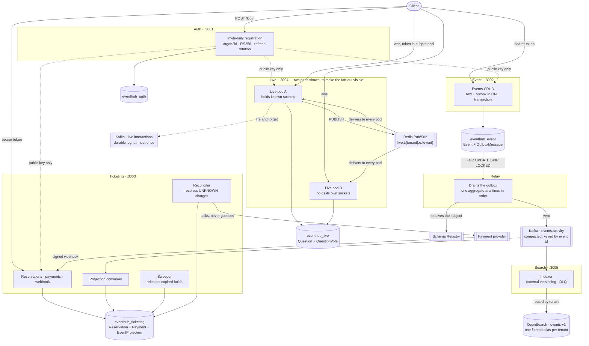

# EventHub

A multi-tenant event and community platform, built as seven services over
Postgres, Kafka, Redis, OpenSearch and ClickHouse.

It exists to be **explainable**. Every non-obvious decision in this repository has
a comment saying what it is working around, and most of them are working around
something specific — a Postgres behaviour, a Kafka guarantee, or a failure that
was observed rather than imagined. Where the code claims a property, there is
usually a script that demonstrates it and a CI step that re-checks it on every
pull request.

## The problems it actually solves

Anyone can wire up CRUD. These are the parts that took thought.

**Two people buy the last seat at the same time.** The naive read-then-write has
no protection under `READ COMMITTED` — both transactions read `remaining = 1`,
both conclude they may proceed, and the seat sells twice. Wrapping it in a
transaction changes nothing, because transactions give atomicity, not mutual
exclusion. The fix is to make the check and the write *one statement*, so the
second transaction blocks on the row lock and then re-evaluates its `WHERE`
clause against the newest committed row. CI fires 40 concurrent buyers at 5 seats
and asserts exactly 5 succeed.

**The payment provider doesn't answer.** Not fails — *fails to answer*. The
charge may have succeeded and the reply may have been lost, and nothing on this
side can tell. So `UNKNOWN` is a first-class state, distinct from `FAILED`:
rounding "I don't know" down to "no" releases seats that were genuinely paid for.
An unanswered charge keeps its seats held and stays unsettled, and a reconciler
resolves it later by **asking the provider** rather than guessing. There are
exactly two wrong ways to resolve a stuck charge and one right one.

**The money and the seats live in different systems.** There is no transaction
spanning both, so the payment endpoint is three phases with a commit between
each. One transaction wrapped around the provider call is wrong twice over: it
holds a row lock across a network call, and it's a lie — the database can roll
back, the charge cannot.

**A webhook arrives with no tenant.** Every row-security policy here reads
`app.tenant_id`, so the application role sees *zero rows* for a payment that
plainly exists. The tempting fix is to read the tenant off the signature-verified
payload — but authenticity is not authority; that would let the request choose
whose rows it modifies. The webhook says *which payment*; the database says
*whose*. The cross-tenant reach is one `SELECT` of one column.

**One service can't join to another's tables.** Database-per-service with
`CONNECT` revoked means Ticketing genuinely cannot read Event's data. So it
consumes an event stream and maintains a projection instead. That is the honest
price of the architecture: a join becomes a subscription, and you inherit
at-least-once delivery, out-of-order arrival, and the need to dedupe.

## Tenant isolation is enforced by Postgres, not by application code

Row-level security with `FORCE`, role-targeted policies, and a per-transaction
session variable. Three details make it real rather than decorative:

- A table owner **silently bypasses its own policies**, so services connect as a
  separate non-owner role. Migrations run as the owner and therefore see zero
  rows under `FORCE` — which has bitten this repo three times during backfills,
  each one documented in the migration that hit it.
- Foreign keys, unique constraints and cascading deletes all run **outside** row
  security. So every child references a `(tenantId, id)` pair rather than a bare
  id, and no unique index omits `tenantId` — otherwise a `23505` would reveal that
  another tenant already used a value.
- Grants are explicit per table, with no `ALTER DEFAULT PRIVILEGES`. A forgotten
  policy is therefore also a forgotten grant, and the service fails loudly instead
  of quietly serving rows across every tenant. **Fail closed.**

CI asserts that no table anywhere is missing RLS unless it is on a documented
exemption list — and each exemption has to be justified in its migration, because
an exemption nobody wrote down is indistinguishable from a policy somebody forgot.

## What's here

| | |
|---|---|
| `services/auth` | Invite-only registration, argon2id, RS256 JWTs, refresh rotation with family reuse detection, password reset |
| `services/event` | Events CRUD with a transactional outbox |
| `services/relay` | Drains an outbox, Avro-encodes, publishes to Kafka, dead-letters poison rows |
| `services/ticketing` | Projection consumer, the organiser's ticket types (within the event's capacity, edited optimistically), seat reservation, hold sweeper, payment path, payment reconciler, provider webhook, and the buyer's own reservations, each with its latest payment attempt and a countdown on the database's clock |
| `services/live` | Authenticated WebSockets for live Q&A, fanned out across pods with Redis Pub/Sub |
| `services/search` | Event search on OpenSearch: a Kafka indexer keeps one shared index current with external versioning, each tenant is confined by a filtered alias, and `GET /search` ranks, facets, and falls back to a capped Postgres query when the cluster is down |
| `services/analytics` | ClickHouse behind two users: a raw append-only event table and materialized-view rollups for the ticket funnel and live engagement, filled by a Kafka ingest that counts each message once by its id, and read through an API that takes the tenant from the token and answers organisers and admins only. The ingest's `/metrics` shows consumer lag in offsets and part counts beside the server's limits, and every rollup rebuilds from the raw table |
| `services/notification` | The one service that sends email. It opens each sealed request, a password reset or an invitation, with its own private key, acts only on what Auth's signature verifies, claims the delivery in a sent-log under row-level security before sending, and sends through Mailpit locally. A redelivered message sends nothing |
| `contracts/` | Avro schemas, and TypeScript types generated from them |
| `services/community` | Spaces, posts, threaded comments on a Postgres `ltree` path, reactions and moderation. Every table is tenant-scoped under forced row-level security, the moderation trail is append-only at the privilege level, and posts leave through the same outbox and relay the other services use. Space roles are read per request and cached in Redis for a minute, dropped by whatever changes them, so a promotion or a ban takes effect on the next call; writes pass a per-user, per-tenant token bucket evaluated atomically inside Redis. A feed consumer reads `community.feed` back and fans a post out to the members of small spaces, leaving large ones to be read at query time; which half a post is in is decided once and recorded on it. The feed pages on when a post was made, so a moving score can never skip or repeat one, and ranks each page by the post's own score, read at query time — a fanned-out row is written once and never changed |
| `infra/kong/` | The gateway: Kong OSS, DB-less, one declarative file. Routes each path to the service that owns it, clears every tenant header a client sends, and takes the tenant from the subdomain instead |
| `apps/web` | The attendee web app (TanStack Start, generated by Lovable and finished here): sign in, browse events, reserve with a hold that counts down on the server's clock, pay, and see what you bought. Its own pnpm project and CI job, outside the workspace; run it with `pnpm install --ignore-workspace && pnpm run dev` in `apps/web` and open `http://acme.eventhub.localhost:5173` |
| `db/init/` | Six databases and nineteen roles, with `CONNECT` revoked from `PUBLIC` |
| `charts/` | The services' Helm charts: `eventhub-common`, a library chart holding the Deployment, Service, PodDisruptionBudget and environment Secret every service shares, and one thin chart for each of the fifteen processes compose runs -- the eight services, Ticketing's sweeper and reconciler, Analytics' ingest and the four outbox relays. Probes are split -- liveness on `/health`, readiness on `/ready` -- and `verify-helm-charts.mjs` checks each path against the routes the service registers, and every chart against the process compose runs |
| `infra/local/` | A local kind cluster (one control plane, two workers) that runs the charts against the data stores compose runs. `node infra/local/up.mjs` creates it, bridges compose's Postgres, Kafka and the rest in as Services, and installs every chart; versions and commands are in `infra/TOOLVERSIONS.md` |
| `infra/argocd/` | GitOps for the cluster: a root Application (app-of-apps) whose ApplicationSet makes one Application per service chart, from `main`, with automated sync that prunes and self-heals. `node infra/argocd/bootstrap.mjs` installs ArgoCD on the kind cluster and hands it the repository through a read-only deploy key kept outside the repo; the services' environment Secrets are made beside the charts, never in git |
| `infra/terraform/` | The AWS demo environment in Terraform, every resource written out with no registry modules: a bootstrap root (the S3 state bucket and a $10 monthly budget), then a VPC with one NAT gateway, an EKS cluster with one managed node group (its instance types checked at plan time against what the account can launch) and EKS Pod Identity, the ECR repository, and the Load Balancer Controller's role. State locks in S3 itself (`use_lockfile`). Terraform stops at the cluster boundary; the apply order, an hour's cost and the teardown runbook are in `infra/terraform/README.md`, and `verify-terraform.mjs` checks it all without an AWS account |
| `scripts/verify-*.mjs` | 106 executable proofs of the invariants above |

Six separate Postgres databases with their own credentials. CI reads every
database and login role from `db/init` and asserts that no role can even open a
connection to a database it was not granted.

## How it fits together



**The dotted lines are not calls.** Auth is the only service holding a private
key; Event and Ticketing hold only the public half, so they can prove a token is
genuine and cannot mint one. A compromise of either grants no ability to forge an
identity, which is the whole reason for RS256 rather than a shared secret.

**The solid line that matters most is `DBEVENT → RELAY`.** Event never publishes
to Kafka. It writes the event row and an outbox row in one transaction, so there
is no window where the row exists and the message does not, or the reverse — the
failure every "save, then publish" design has. The relay is what turns those
committed rows into messages, and everything hard about this repository lives in
that hop: ordering per aggregate, at-least-once delivery, retries with backoff,
poison rows that must dead-letter rather than block their aggregate for ever.

**The two Live pods and the Redis loop are the one thing a diagram explains
better than prose.** A WebSocket is a file descriptor owned by one process, so
pod B cannot write to a socket held by pod A. A question posted on A is written
to Postgres, then PUBLISHed to a channel keyed by tenant and event; Redis
delivers it to every pod holding a client in that room — **including pod A
itself**, which is why A must not also write to its own sockets or everyone on it
sees the message twice. The channel name carries the tenant from the signed
token, so a client cannot subscribe outside its own tenant by construction rather
than by a check someone might forget.

`live.interactions` is dotted because it is produced fire-and-forget, with no
outbox. That is the one place in this repository where the outbox pattern is
deliberately **not** applied: losing a `tickets.purchased` is a financial
incident, and losing an upvote is a rounding error in an analytics rollup.

**And `KAFKA → PROJ` is the price of database-per-service.** Ticketing cannot
join to Event's tables — `CONNECT` is revoked, so it genuinely cannot reach them —
so it subscribes and maintains its own projection. That buys isolation and costs
at-least-once delivery, out-of-order arrival and the need to dedupe, which is why
the projection carries a source version and refuses to go backwards.

The topic is **compacted**, so Kafka keeps only the last message per key. That
makes the ordering above load-bearing in a way that is easy to miss: publish v3
before v2 and compaction keeps v2, so a rebuild from the topic reconstructs the
wrong state — permanently, and silently. `scripts/verify-projection-rebuild.mjs`
is what holds that line.

## Running it

Two ways. The first needs nothing installed but Docker and is how to see the
system work; the second is how to develop on it.

### Everything in containers, one command

```bash
docker compose up -d --wait
```

That builds one image, shared by every application service, and then:

1. waits for Postgres, Redis, Kafka, the Schema Registry, OpenSearch, ClickHouse and Mailpit to pass their healthchecks
2. runs a `setup` container that migrates all six databases, seeds Auth,
   creates the Kafka topics, registers the Avro schemas, creates the search index,
   migrates ClickHouse, and generates a signing keypair into a volume
3. and only then starts Auth, Event, Ticketing, Live, Search, Analytics, its Kafka ingest, Notification, Ticketing's hold sweeper and payment reconciler, and the outbox relays for Event, Ticketing and Auth

Beside them it starts the gateway, Kong, on port 8000.

The sweeper and the reconciler are containers of their own with no port, because they
work across tenants, on a credential bounded by grants rather than the API's
tenant-scoped one. The reconciler asks the
provider about any charge that has gone unanswered for 20 seconds, so a payment
answered `202` here is confirmed, or its seats returned to a hold, within about half
a minute; `node scripts/verify-compose-payment-reconciler.mjs` pays twice through the
gateway and watches both happen. Both were once processes compose never started, so
`scripts/verify-compose-starts-every-process.mjs` now fails the build on any file under
`services/*/src` that runs a `main()`, handles SIGTERM or listens, unless a compose
service runs it or it is a one-shot under `src/scripts/`.

`--wait` returns when every container is **healthy**, so a zero exit status means
the system is up rather than merely that the containers were created.

Search's indexer fills the index from `events.activity` as soon as it starts,
replaying the compacted topic from the beginning, so an event created before
Search existed is still found. Search reads it with the same token:

```bash
curl -sf "http://acme.eventhub.localhost:8000/search?q=smoke" -H "Authorization: Bearer $TOKEN"
```

That answers with an empty `hits` list, and that is correct. The `Smoke` event
above is a DRAFT: it is in the index, but public search shows only published,
upcoming events, so it appears once `POST /events/:id/publish` has published it.
An empty result for a draft is the policy working, not the indexer failing.

| Service   | URL                     |
| --------- | ----------------------- |
| The gateway, as tenant `acme` | `http://acme.eventhub.localhost:8000` |
| Auth      | `http://localhost:3001` |
| Event     | `http://localhost:3002` |
| Ticketing | `http://localhost:3003` |
| Live      | `http://localhost:3004`, WebSockets on the same port |
| Search    | `http://localhost:3005/metrics` |
| Analytics | `http://localhost:3006/ready` |
| Analytics ingest | `http://localhost:3016/metrics` |
| Notification | `http://localhost:3007/ready` |
| Community | `http://localhost:3008/ready` |
| Mailpit, the local email inbox | `http://localhost:8025` |
| Event relay | `http://localhost:3010/metrics` |
| Ticketing relay | `http://localhost:3011/metrics` |
| Auth relay | `http://localhost:3012/metrics` |
| Community relay | `http://localhost:3013/metrics` |

**Through the gateway, the tenant is the subdomain.** `acme.eventhub.localhost`
is tenant `acme`; any `*.localhost` name resolves to your own machine without a
hosts-file entry. Kong clears any `X-Tenant-ID` or `X-Tenant-Slug` a client sends
and passes the subdomain on as `X-Tenant-Slug`, so a request cannot name its own
tenant; Auth turns the slug into a tenant when you sign in, and every other
service takes the tenant from the token. The token names its subdomain too, so
an acme token on `globex.eventhub.localhost` is refused with 403 rather than
quietly acting on acme. Paths are each service's own (`/events`,
`/reservations`, `/spaces`...), except Auth's, which sit under `/auth`. The
payment webhook and the unsubscribe link carry no tenant and live on
`api.eventhub.localhost`.

On the way through, every request gets an `X-Request-ID`, which the service
receives and the response carries. On every route where each path needs a token
(Event, Ticketing, Search, Analytics, Notification's preferences, Community), Kong
checks the token's signature and expiry with Auth's public key before the service
sees it; the services still verify everything themselves, audience included. CORS is answered for tenant subdomains only
(`https` in production; any port on `*.eventhub.localhost`). Bodies over 1 MB are
refused, chunked or not. Each client address gets 600 requests a minute, 120 on
`/auth`, counted in Redis so every Kong node shares one count; on a route with a
signature check the count starts after it, so a request without a valid token is
refused with 401 and not counted. Each request is logged as one JSON line that
keeps an allowlist of headers and no query string, so no token, cookie or
`Authorization` reaches the log.

Every port in the table below is published on 127.0.0.1 only, for tools and
verifiers on this machine; from anywhere else the gateway on port 8000 is the one
way in. On this machine the services' own ports still bypass it: a client on
Auth's port can name any slug and, since Auth trusts one proxy hop to tell it the
caller's address, its own address too. Inside the compose network every container
can still reach every service directly; that isolation is the Kubernetes
chapters' NetworkPolicy.

Proof that it is working end to end, rather than just listening — sign in as the
seeded admin, create an event through one service, and read it back out of
another service's Kafka-fed projection:

```bash
TOKEN=$(curl -sf -X POST http://acme.eventhub.localhost:8000/auth/login \
  -H 'Content-Type: application/json' \
  -d '{"email":"alice@acme.com","password":"hunter2222"}' \
  | grep -o '"accessToken":"[^"]*"' | cut -d'"' -f4)

curl -sf -X POST http://acme.eventhub.localhost:8000/events \
  -H "Authorization: Bearer $TOKEN" -H 'Content-Type: application/json' \
  -d '{"title":"Smoke","capacity":42,"startsAt":"2027-11-01T10:00:00Z","endsAt":"2027-11-01T18:00:00Z"}'

docker exec eventhub-postgres psql -U eventhub -d eventhub_ticketing \
  -c 'SELECT title, status, capacity FROM "EventProjection"'
```

The last command reading back a row is the interesting part: it means Event wrote
an outbox row, the relay claimed it and resolved its Avro schema, Kafka carried
it, and Ticketing's consumer projected it. Four containers and a broker, not one
request.

`setup` runs to completion and exits, and every service waits on
`service_completed_successfully`, so a failed migration stops the start rather
than leaving four containers that are up and broken. Re-running is safe: an
existing keypair is kept rather than rotated — rotating it would invalidate every
token already issued — and the migrations, topic creation and schema
registrations are each idempotent.

`docker compose down` stops it. Add `-v` to discard the databases and the
keypair too.

### Developing on it, with the services on your host

Node is pinned in `.nvmrc` and CI reads the version from that same file, so there
is one place to change it. `pnpm` is pinned via `packageManager`.

```bash
pnpm install && pnpm build
```

Bring up only the infrastructure, naming the containers so the application
services stay down and the ports stay free for the ones you run yourself.
`--wait` blocks until every healthcheck passes, so nothing below races a
half-started broker:

```bash
docker compose up -d --wait postgres redis kafka schema-registry opensearch clickhouse mailpit
```

The Postgres container creates all six databases and their roles on first boot
through its own `/docker-entrypoint-initdb.d` hook, so there is no separate
bootstrap step. First boot only: the hook never runs against an existing data
volume, so a volume created before a service's database was added does not have
it. `docker compose down -v` recreates the volume and discards its data; the
alternative is to run that service's lines from `db/init/01-bootstrap.sql` as the
`eventhub` superuser.

Each service ships a committed `.env.example`; copy it to `.env` (the real one is
gitignored). Each one that owns a database carries **two** connection strings on purpose — `DATABASE_URL`
owns the tables and runs migrations, `APP_DATABASE_URL` owns nothing and is what
the service connects as at runtime. That separation is what makes row-level
security work at all.

Then migrate each service. All six have their own migrations, and each reads
the `DATABASE_URL` from its own `.env` — which is why the copy above has to
happen first:

```bash
pnpm --filter @eventhub/auth exec prisma migrate deploy
```

```bash
pnpm --filter @eventhub/event exec prisma migrate deploy
```

```bash
pnpm --filter @eventhub/ticketing exec prisma migrate deploy
```

```bash
pnpm --filter @eventhub/live exec prisma migrate deploy
```

```bash
pnpm --filter @eventhub/notification exec prisma migrate deploy
```

```bash
pnpm --filter @eventhub/community exec prisma migrate deploy
```

Only Auth has a seed. Running this against Event or Ticketing fails with a
missing seed script rather than doing nothing:

```bash
pnpm --filter @eventhub/auth exec prisma db seed
```

Create the Kafka topics. The broker runs with
`KAFKA_AUTO_CREATE_TOPICS_ENABLE=false` deliberately, so this is not optional
and nothing will create them for you:

```bash
node scripts/create-topics.mjs
```

Register the Avro schemas, which the relay resolves by subject at publish time:

```bash
node scripts/register-schemas.mjs
```

Skipping either of those last two leaves a system that starts cleanly and then
fails at the first publish, with an error that names neither the missing piece
nor the script that creates it — the broker says `This server does not host this
topic-partition`, and the registry 404s on a subject nobody registered.

Create the search index. It is a schema in the same sense the migrations are, so
it comes from a checked-in definition rather than from the first write —
OpenSearch would otherwise infer a mapping from whatever document arrived first,
and it would type `tenantId` as analysed text, which is the one field tenant
isolation rests on. Re-running it is safe:

```bash
pnpm --filter @eventhub/search run bootstrap:index
```

Create the analytics schema in ClickHouse. The runner connects as
`analytics_migrator`, the only user that can create a table; the service itself
runs as `analytics_app`, which can only read and insert. It is idempotent, and it
refuses a migration that was edited after it was applied:

```bash
pnpm --filter @eventhub/analytics run migrate
```

Finally, a throwaway signing keypair:

```bash
node services/auth/scripts/generate-keys.mjs
```

And Notification's keypair, which Auth seals reset and invitation emails to. It keeps an
existing pair, copies only the public half into `services/auth/keys`, and Auth
refuses to start without that copy:

```bash
node services/notification/scripts/generate-keys.mjs
```

Keys are gitignored. Never reuse a real signing key here — anything in a build
environment is readable by anything else running there.

**`.github/workflows/ci.yml` is the authoritative setup for this second path.**
It brings up the same `docker-compose.yml` a laptop does — naming the same
infrastructure services, with the same healthchecks and the same config — and
then runs the application services from the working tree exactly as the steps
above do. So the two cannot drift. If anything in this section disagrees with the
workflow, believe the workflow.

CI deliberately does **not** exercise the container path. It builds from the
working tree, so running an image built from that same tree would add a build and
verify the same code twice; and a bare `docker compose up -d --wait` would start
the application containers on 3001–3005, and CI starts its own on 3001–3003. The
container path is a way to run the system, not a second thing to test.

That sentence was doing more work than it should have. The instructions above
used to migrate one service of three and never mention topics or schemas at all,
and "believe the workflow" was the only thing standing between a reader and a
broken setup. `scripts/verify-readme-setup.mjs` now asserts that everything CI
runs to make the system usable appears here, so a new setup step is a red build
until it is either documented or recorded as one a human does not need.

## On the verification scripts

They aren't unit tests. Each one demonstrates a property that is invisible from
outside the system and that the schema cannot express:

- seats cannot be oversold under real concurrency
- a price cannot move under a buyer mid-checkout
- two sweepers return each seat exactly once
- an unanswered charge leaves its seats held
- reconciliation resolves both directions rather than guessing
- a refresh token can be spent only once, **even under a race**
- a password reset actually changes the password

That last pair matter because their failure modes are silent. A refresh token
double-spend leaves reuse detection *blind* rather than bypassed — each racer
walks away with a distinct successor, so no token is ever presented twice and
the detector has nothing to see. A password reset written without tenant context
matches zero rows, which a guarded `updateMany` reports as a count of 0 rather
than an error: the endpoint returns 200, the token is spent, and the password
never changed.

Every assertion here has been watched fail against deliberately broken code
before being trusted. An assertion nobody has seen go red is a guess.

## Status

Chapters 1–6 are built: foundations, auth and RLS, the Event service and the
Kafka backbone, Ticketing through payments, live Q&A over WebSockets, and search.
Search covers:

- the index and per-tenant isolation
- the Kafka indexer
- the query API, with its degraded fallback to Postgres
- deep pagination
- zero-downtime migration to a new index
- indexer lag and query metrics on `/metrics`

A mapping or analyzer change ships by bumping `INDEX_VERSION` and running
`pnpm --filter @eventhub/search run reindex`. Tracing across services is not built.

Chapter 7, analytics, is built. ClickHouse storage with its rollups, and the Kafka
ingest that fills it: one row per ticket line, each message counted once by its
id however Kafka redelivers it, and poison kept in `ingest_dlq` without blocking
its partition. The read API on 3006 serves an event's ticket funnel and live
engagement, and a tenant overview. The tenant comes from the token, and every
route is checked against another tenant's event. The failure drills run in CI:
- too many parts, visible in `/metrics` before inserts are refused;
- ClickHouse unreachable, which is lag that drains with nothing lost;
- a corrupted rollup rebuilt from the raw table.

A rollup rebuild is `pnpm --filter @eventhub/analytics run rebuild-rollups`, with
the ingest stopped first: a row that lands mid-rebuild would be counted twice.
Chapter 8, notifications, is in progress. A password reset now reaches the inbox.
Auth queues it encrypted to Notification's key and signed with its own, the relay
publishes it, and Notification opens it, claims the delivery once and sends it. In
compose it arrives at Mailpit, `http://localhost:8025`.

An invitation travels the same way. `POST /invites` commits the invitation and its
sealed request together, so the invitee gets one email with the link and the role
and nothing else, and no unsubscribe: an invitation is not a subscription. Inviting
an address again revokes the earlier link, and `POST /invites/revoke` stops an
emailed one. Every invitation is mail the platform sends to an address an admin
typed, so `POST /invites` is budgeted per tenant: `INVITES_PER_TENANT_PER_HOUR`
(100) and `INVITES_PER_ADDRESS_PER_DAY` (3), and past either it answers 429. The
address budget counts mailboxes, not spellings: a `+tag`, and dots at Gmail, do not
buy a fresh one. An invitation lives `INVITE_TTL_HOURS` (at most a week), and
`auth.email-requested` keeps a request eight days, so a dispatcher outage cannot
outlast an invitation and lose it. A dead-lettered invitation replayed after the
sweep has ended its claim is still sent, once.

Every emailed link opens on the tenant's own subdomain, because that is where the
tenant's pages are: Kong takes the tenant from the host, and a session is bound to it.
The base is `APP_URL_TEMPLATE`, with `{tenant}` where the slug goes —
`http://{tenant}.eventhub.localhost:5173` in compose, the web app's dev server, and
`https://{tenant}.eventhub.com` in production. A reset asked for on
`acme.eventhub.localhost` links to `http://acme.eventhub.localhost:5173/reset-password?token=…`,
and the same address on `globex` gets a globex link; an invitation opens on the
inviting tenant's host, which is where `/register`'s new user has to be signed in.
Reply and digest links (`/posts/<id>`) open on the recipient's tenant's host, from
the slug Auth signs into each user's contact card. Auth and Notification both refuse to
start without the template, or with `{tenant}` anywhere but the first label of the
host, and only a slug the gateway would route is ever put into it. It replaces
`PUBLIC_APP_URL`, which was one host for every tenant and served none, so a `.env`
copied from an older example has no template, and the service says so as it refuses:
copy the line from `.env.example`. The unsubscribe
link is the exception, on purpose: it stays on `NOTIFICATION_PUBLIC_URL`, one host
with no tenant, since its signed token names the tenant.

A contact card made before cards carried the slug has none, and that user's replies
and digests go out without the post links — never with a link to the wrong host —
until the card is made again. `setup` does that on every `up`: its
`contact-cards:publish` queues a card for every user who never had one and every user
whose card was not made under their tenant's current slug, and a second run queues
nothing.

A send that fails for a reason that may pass waits in delayed retry tiers
(`notification.retry.1` to `.3`) without holding up anyone else on its partition.
Poison, and a send whose retries run out, go to `notification.dlq`, which is never
replayed automatically. Once whatever put it there is fixed, replay one by its
message id; a delivery already sent is not sent again:

```bash
pnpm --filter @eventhub/notification run dlq:replay -- <message-id>
```

An address the relay refuses as non-existent (a 5.1.x reply to RCPT TO) is suppressed
for its tenant: later deliveries to it are recorded SUPPRESSED and never attempted.
Only that reply suppresses. A policy block (5.7.x) or a bare 550 is recorded FAILED
and tried again next time, because a wrong suppression would lock its owner out of
password resets. For the same reason a suppression ends after `SUPPRESSION_TTL_DAYS`,
and every later bounce moves that end out again. The table holds a hash of the
address, never the address. To lift one by hand:

```bash
pnpm --filter @eventhub/notification run suppression:remove -- <tenant-id> <address>
```

A delivery is claimed PENDING before anything is sent, and Kafka re-drives nearly all
of them. The ones that never move again — a dead-lettered message, or one whose
retention passed — are ended by a sweep inside the service, on its own credential:
they become FAILED with "abandoned", so PENDING means "in flight" and its count is
worth alerting on. That credential may end a delivery and nothing else, and the
service refuses to start on one that can do more. `SWEEP_STUCK_AFTER_MS` sets how
long is too long; one pass by hand is:

```bash
pnpm --filter @eventhub/notification run sweep:once
```

The whole chain is proved in the compose stack itself, not only against natively run
services: `node scripts/verify-compose-password-reset.mjs` adds one address to both
seeded tenants, asks for a reset in each, reads the mail out of Mailpit, and checks
that each link opens its own tenant's subdomain and resets only that tenant's account,
that the old password stops working and that the session issued before the reset is
revoked — then removes what it made. Locally the mail arrives about a second after the
request.

Replies are the second email, and the first anyone can turn off. When someone
answers your comment or post in Community, Notification emails you — never about
your own reply, never once you can no longer read the space, never an hour late — with
a one-click unsubscribe that works without logging in. A password reset can never be
turned off. Past five reply emails in an hour, the rest are held and go out as one
digest an hour, which carries counts and links and none of the replies' words. The
digest finds who is waiting on a credential of its own that can read three columns
and nothing else; one pass by hand is:

```bash
pnpm --filter @eventhub/notification run digest:once
```

Known gaps, named rather than hidden:

- Analytics answers per tenant, not per organiser. Its rows carry no organiser,
  so any organiser or admin sees every event in their tenant. And ClickHouse has
  no equivalent of the non-owner Postgres role behind it: isolation rests on the
  service binding the token's tenant into every query, which
  `scripts/verify-analytics-api.mjs` checks route by route.

- No API gateway, so rate limiting exists only inside the Auth service and only
  in process memory.
- Access tokens are 15-minute stateless RS256 with no revocation list, so a
  password reset kills refresh tokens immediately but cannot evict an access
  token already issued.
- Notification cannot see a revocation. An invitation revoked after it was queued
  but before it was sent still goes out, with a link `/register` refuses.
- Invitations share the password-reset topic and its consumer, so a reset can wait
  behind the invitations on its partition: measured at 32 ms an invitation here, a
  reset behind sixty went out 2.1 s late. It takes about a hundred tenants spending
  their whole hourly invitation budget at once, against a slow provider, to cost a
  reset its half hour; past that, invitations want a topic and a route of their own.
